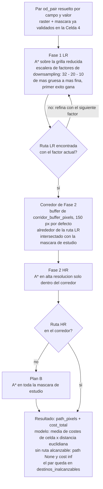

# LCP_MCP_Geometric

LCP_MCP_Geometric es una herramienta de análisis espacial para el cálculo de rutas de menor coste entre múltiples puntos sobre superficies raster, orientada a aplicaciones arqueológicas: modelar movimientos en el territorio a partir de un ráster de fricción o coste. El motor MCP es `skimage.graph.MCP_Geometric` (Dijkstra exacto, 8 vecinos) y la reconstrucción de caminos está acelerada con Numba JIT.

- **4 modos de análisis**: red completa (`all_pairs`), modo estrella (`single_origin`), dos capas (`cross_layers`) y una única ruta por campo/valor (`od_pair`).
- **2 kernels de cálculo**: `mcp_geometric` (default, todos los modos) y `corridor_astar` (A* jerárquico dirigido al objetivo, solo `od_pair`).
- **Ejecución paralela en dos fases** con joblib, auto-detección de workers por RAM disponible, reanudación (`RESUME`) y escritura atómica e incremental.
- **Post-procesamiento**: puntos densificados vectorizados (Celda 8) y mapas de calor KDE estilo QGIS (Celda 9).
- Suite de **285 tests** pytest, lint con `ruff`, ejecución parametrizada con `papermill`.

## Diagrama del flujo completo

El flujo completo del notebook `LCP_MCP_Geometric.ipynb` (9 celdas de código, cada una precedida de su celda markdown explicativa en español):

```mermaid
flowchart TD
    C1["Celda 1 - Importaciones<br/>numpy - rasterio - fiona - geopandas - skimage - numba<br/>y el paquete lcp"]
    C2["Celda 2 - Hardware y workers<br/>RAM - nucleos fisicos/logicos - disco<br/>modelo medido de memoria: 76 B por pixel y worker en Fase 1<br/>y 2 B por pixel en Fase 2<br/>sugerencia de workers con MAX_WORKERS_PHASE1 como tope<br/>+ warm_up_numba"]
    C3["Celda 3 - Parametros de usuario<br/>ANALYSIS_MODE: all_pairs - single_origin - cross_layers - od_pair<br/>KERNEL: mcp_geometric - corridor_astar<br/>HEURISTIC_WEIGHT - rutas de datos - EDGE_BUFFER_PX<br/>RESUME - MAX_WORKERS_PHASE1 - SPACING_M - HEATMAP_*"]
    C4["Celda 4 - Validacion de coherencia<br/>CRS identicos raster/puntos/mascara - solape espacial<br/>todos los puntos en pixeles validos - mascara no total<br/>mismo pixel sitio/fuente en cross_layers<br/>selector estricto de od_pair con preview de candidatos<br/>check_kernel: corridor_astar solo en od_pair"]
    C5["Celda 5 - Mapa diagnostico del raster con los puntos<br/>origen resaltado en single_origin - dos capas en cross_layers"]
    C6{"Celda 6 - Ejecucion principal<br/>según KERNEL"}

    K1["Kernel corridor_astar - solo od_pair<br/>una ruta directa 1 a 1 sin dos fases paralelas"]
    KR["A* jerarquico: Fase 1 en baja resolucion<br/>factores 32 - 20 - 10, primer exito gana"]
    KC["Corredor: buffer de 150 px alrededor de la ruta LR<br/>intersectado con la mascara de estudio"]
    KH["Fase 2 en alta resolucion dentro del corredor<br/>sin ruta en el corredor - Plan B: A* en toda la mascara"]
    KG["GPKG unificado con la unica ruta<br/>capas rutas_unificadas y destinos_inalcanzables siempre presentes"]

    M1["Paso 2 - Memmap compartido del raster en disco<br/>huella de reanudacion: modo - origen - par od - direccion<br/>puntos - identidad del raster - mascara - EDGE_BUFFER_PX<br/>en phase1_meta.json"]
    P1["Paso 3 - Fase 1: MCP en paralelo por raiz u origen<br/>MCP_Geometric sobre el memmap - guarda el traceback int16<br/>en phase1_tracebacks/traceback_id.npz + escalares de coste<br/>RESUME: reutiliza los npz con la misma huella<br/>fail-hard: un worker fallido detiene antes de escribir"]
    P2["Paso 4 - Fase 2: reconstruccion streaming con Numba njit<br/>cada lote se escribe directo al GPKG temporal<br/>sin acumular rutas en RAM"]
    MG["Paso 5 - Escritura final atomica<br/>modos legacy: red_completa_unificada.gpkg<br/>capas rutas_unificadas y destinos_inalcanzables<br/>cross_layers: un GPKG por raiz en rutas_por_origen<br/>+ manifest_rutas_por_origen.csv reescrito tras cada raiz"]

    C7["Celda 7 - Mapa final de la red<br/>con escala y norte - CRS armonizado<br/>un PNG por raiz en cross_layers"]
    C8["Celda 8 - Puntos densificados sobre las rutas<br/>SPACING_M metros - Shapely 2.0 vectorizado<br/>columna route_idx"]
    C9["Celda 9 - Mapa de calor KDE estilo QGIS<br/>HEATMAP_RES_M - HEATMAP_BANDWIDTH_M - HEATMAP_KERNEL<br/>binning numpy + convolucion FFT scipy.fft<br/>georreferenciacion exacta - GeoTIFF + PNG"]

    C1 --> C2 --> C3 --> C4 --> C5 --> C6
    C6 -- "corridor_astar, solo od_pair" --> K1
    K1 --> KR --> KC --> KH --> KG
    C6 -- "mcp_geometric, default, todos los modos" --> M1
    M1 --> P1 --> P2 --> MG
    MG --> C7 --> C8 --> C9
    KG --> C7
```



Las secciones de este README están mapeadas a las etapas del diagrama: «Método de trabajo» describe cada celda en orden, «Modos de análisis» y «Kernel de cálculo» detallan las dos ramas de la Celda 6, «Formato de salida» describe los artefactos de la escritura final, y «Post-procesamiento» cubre las Celdas 8 y 9.

## Estructura del proyecto

### Carpetas principales

- **`data/`**: Archivos de entrada (ráster de coste, shapefile/GeoPackage de puntos, máscara poligonal).
- **`output/`**: Resultados de cada sesión, organizados por marca de tiempo (ignorado por git).
- **`lcp/`**: Módulo principal con la lógica del proyecto:
  - `data_loader.py`: Carga el ráster, los puntos y la máscara vectorial; valida IDs duplicados y explota `MultiPoint`. Incluye `load_point_candidates` + `select_point`: selección estricta de UN punto por campo/valor para `od_pair`, sin fallback silencioso al fid.
  - `processing.py`: Procesamiento raster, creación de máscaras y conversión de coordenadas mundo↔píxel.
  - `pathfinder.py`: Motor MCP (`MCP_Geometric`), reconstrucción de traceback con Numba, worker de Fase 1 (`compute_and_save_cost_surface`) y el kernel alternativo `corridor_astar_route`.
  - `postprocessing.py`: Extracción de rutas desde disco (worker de Fase 2), con la variante invertida de `cross_layers` (`reconstruct_inverted_routes_from_disk`) y el descarte de costes no finitos.
  - `planner.py`: Planificador puro (sin E/S) de pares por raíz MCP para los cuatro modos (`build_pair_plan`) y detección de pares en el mismo píxel (`identical_pixel_pairs`).
  - `outputs.py`: Nombres canónicos de los artefactos por raíz, manifiesto CSV y escritura atómica por archivo.
  - `resources.py`: Modelo de memoria por worker medido (76 B/px en Fase 1, 2 B/px en Fase 2), detección de hardware y sugerencia de workers.
  - `utils.py`: Construcción del registro de ruta (`build_route_record`) y guardado legacy a shapefile.
  - `__init__.py`: Inicialización del paquete.

### Archivos principales

- **`LCP_MCP_Geometric.ipynb`**: Notebook principal de ejecución paso a paso (9 celdas de código).
- **`tests/`**: Suite de pytest (`uv run pytest tests/` — 285 tests).
- **`run_notebook.py`**: Ejecuta el notebook de forma no interactiva con nbconvert (timeout 30 min/celda).
- **`LCP_MCP_Geometric.py`**: Export del notebook; se regenera con `uv run jupyter nbconvert --to script LCP_MCP_Geometric.ipynb` (no editar a mano).
- **`pyproject.toml`** / **`uv.lock`**: Configuración, dependencias y bloqueo de versiones.
- **`requirements.txt`**: Volcado fiel de `uv.lock` para la ruta alternativa con `pip`.
- **`CHANGELOG.md`**: Historial de cambios por hito.
- **`CITATION.cff`**, **`LICENSE`**: Metadatos de citación y licencia (CC BY-NC 4.0).
- **`AGENTS.md`**: Instrucciones para agentes de IA que operan el repositorio.

## Características principales

- **Motor MCP con conectividad completa**: `MCP_Geometric` de scikit-image (Dijkstra exacto con coste geométrico, 8 vecinos, `fully_connected=True`).
- **Traceback acelerado y acotado**: reconstrucción con Numba `@njit`; el buffer del path está limitado a `filas + columnas` del ráster y todo acceso al traceback es validado (un traceback corrupto devuelve `None` en vez de tumbar el proceso).
- **Deduplicación por simetría**: en `all_pairs` se calculan N×(N−1)/2 rutas (triángulo superior de la matriz OD); `MCP_Geometric` es simétrico, así que la ruta O→P es idéntica a P→O.
- **Dos kernels de cálculo**: `mcp_geometric` (default) y `corridor_astar`, un A* jerárquico dirigido al objetivo disponible para una ruta 1→1 en `od_pair` (ver «Kernel de cálculo»).
- **Arquitectura de dos fases paralelas** (joblib `loky`): Fase 1 calcula y guarda tracebacks en disco; Fase 2 reconstruye rutas desde disco. Los workers se auto-detectan según RAM disponible con un modelo de memoria **medido** (`lcp/resources.py`).
- **Reanudación (`RESUME`)**: una huella SHA-256 (modo, origen, par od, dirección resuelta, puntos, identidad del ráster, máscara y `EDGE_BUFFER_PX`) en `phase1_meta.json` permite reutilizar los `.npz` sanos y recomputar solo los pendientes tras un fallo de memoria.
- **Tope de workers de Fase 1 (`MAX_WORKERS_PHASE1`)**: limita manualmente el paralelismo cuando la RAM está compartida; la Celda 6 avisa con los GB implicados y recorta si el valor excede el límite seguro.
- **Escritura incremental y atómica**: cada lote de la Fase 2 va directo al GPKG temporal y se renombra con `os.replace` al final — nunca se acumulan rutas en RAM ni queda un GPKG parcial.
- **Fail-hard en Fase 1**: si un worker falla, la ejecución lista los IDs afectados y se detiene **antes** de escribir el GPKG (nunca una red parcial en silencio); los destinos inalcanzables se informan sin bloquear.
- **Máscara de estudio siempre estricta**: solo son navegables los píxeles cuyo centro cae dentro del polígono (sin corredor perimetral de bajo coste); `EDGE_BUFFER_PX` permite excluir además las N filas/columnas exteriores del ráster.
- **Entrada de puntos flexible**: `Point` y `MultiPoint` (un MultiPoint de k ≥ 2 coordenadas se explota en k nodos con ids derivados `id*1000+j`).
- **Selección estricta de puntos (`od_pair`)**: por campo y valor, tolerante a tipos (`"7"`, `7`, `7.0`), sin fallback silencioso al fid y con preview de candidatos cuando los valores quedan en `None`.
- **Verbosidad configurable** (`VERBOSE`) y celdas de validación y diagnóstico antes de calcular nada.

## Método de trabajo

### Celda 1 — Importaciones

Carga de librerías: `numpy`, `rasterio`, `fiona`, `geopandas`, `scikit-image`, `numba` y los módulos del paquete `lcp`. (La barra de progreso con `tqdm.auto` se importa en la Celda 6.)

### Celda 2 — Hardware, workers y warm-up de Numba

Detecta el hardware (RAM disponible, núcleos físicos/lógicos, disco libre) e imprime el pico estimado por worker y los workers sugeridos usando el modelo **medido** de `lcp/resources.py`: **76 B por píxel y worker** en Fase 1 (+30 MB fijos) y **2 B por píxel** en Fase 2. Un estimador del tipo «ráster × 4,5» predice la mitad y provoca `ArrayMemoryError` en `_offset_edge_map` de skimage (que necesita además un bloque **contiguo** de 2·H·W·8 bytes por worker). También define `warm_up_numba()` (pre-compila la función Numba antes del bucle principal y verifica los offsets de `MCP_Geometric`) y `_calculate_n_jobs_for_phase`, que respeta `MAX_WORKERS_PHASE1` como tope (y el límite de 61 procesos de Windows).

### Celda 3 — Configuración central (etiquetada `parameters`)

Todos los parámetros de usuario, precedida de celdas markdown que documentan los modos **dentro del propio notebook**:

| Parámetro | Descripción |
|---|---|
| `COST_RASTER_PATH` | Ruta al ráster de coste/fricción (`.tif`), en CRS proyectado |
| `ALL_POINTS_SHAPEFILE` | Shapefile o GeoPackage con los puntos de la red (usado por `all_pairs`, `single_origin` y `od_pair`) |
| `MASK_SHAPEFILE_PATH` | Polígono de restricción espacial (`None` para desactivar) |
| `ID_FIELD_NAME` | Nombre del campo ID en la capa de puntos |
| `ANALYSIS_MODE` | `"all_pairs"` (default), `"single_origin"` + `ORIGIN_ID`, `"cross_layers"` (dos capas, M×N) o `"od_pair"` (una única ruta por campo/valor) |
| `ORIGIN_ID` | ID del punto origen; requerido y validado en modo `single_origin` |
| `ORIGIN_SELECT_FIELD` / `ORIGIN_SELECT_VALUE`, `DEST_SELECT_FIELD` / `DEST_SELECT_VALUE` | Solo en `od_pair`: campo y valor (número o texto) del punto de inicio y del destino; `None` = tabla de candidatos y detención |
| `ORIGIN_POINTS_PATH` / `DEST_POINTS_PATH`, `ORIGIN_ID_FIELD` / `DEST_ID_FIELD`, `INVERT_DIRECTION` | Solo en `cross_layers`: capa de sitios, capa de fuentes, campo id de cada capa y política de inversión |
| `HEATMAP_ORIGIN_IDS` | Solo en `cross_layers`: `None` = un KDE por cada raíz; lista de ids = solo esas raíces |
| `KERNEL` | `"mcp_geometric"` (default, todos los modos) o `"corridor_astar"` (solo `od_pair`) |
| `HEURISTIC_WEIGHT` | Solo con `KERNEL="corridor_astar"`: peso de la heurística euclidiana (default `1.0`); `0` = Dijkstra exacto (ver «Kernel de cálculo») |
| `EDGE_BUFFER_PX` | Excluye las N filas/columnas exteriores del ráster (`0` = nada) para cortar el corredor perimetral cuando el modelo de coste es poco fiable en los límites |
| `OUTPUT_DIR` | Carpeta de salida (generada automáticamente con marca de tiempo) |
| `VERBOSE` | `True` imprime detalles por ruta |
| `KEEP_PHASE1_FILES` | `False` (default) elimina `phase1_tracebacks/` al finalizar; `True` conserva los `.npz` comprimidos |
| `RESUME` | `True` reutiliza los `.npz` de Fase 1 si la huella coincide |
| `MAX_WORKERS_PHASE1` | `None` = automático; entero = tope de workers de Fase 1 (se recorta con aviso si excede la RAM segura) |
| `SPACING_M` | Celda 8: metros entre puntos densificados (default 25.0) |
| `HEATMAP_RES_M`, `HEATMAP_BANDWIDTH_M`, `HEATMAP_KERNEL` | Celda 9: resolución (30 m), radio (1 km) y kernel (quartic/gaussian/triangular/uniform) |

### Celda 4 — Verificación de coherencia de datos

Valida CRS idénticos (ráster/puntos/máscara), solape espacial y que **todos** los puntos caigan en píxeles válidos (fuera de máscara o `nodata`; los IDs problemáticos se listan). Además:

- `single_origin`: comprueba que el modo sea válido, que haya ≥ 2 puntos y que `ORIGIN_ID` exista.
- `cross_layers`: valida la política `INVERT_DIRECTION`, el CRS y los píxeles válidos de **ambas** capas, y aborta si un sitio y una fuente caen en el **mismo píxel** (una ruta de longitud cero no se puede representar).
- `od_pair`: ejecuta el selector estricto por campo/valor (con los valores en `None` imprime la tabla de candidatos y detiene) y llama a `check_kernel`, que rechaza `corridor_astar` fuera de `od_pair`.
- Avisa si el polígono cubre el 100 % del ráster (entonces no restringe nada).

Cualquier problema **detiene la ejecución** con un mensaje concreto antes de calcular nada.

### Celda 5 — Visualización diagnóstica

Mapa del ráster de coste con los puntos superpuestos para verificar la configuración antes de lanzar el análisis. En `single_origin` resalta el origen con una estrella; en `cross_layers` muestra las dos capas (orígenes en cian, destinos en amarillo).

### Celda 6 — Ejecución principal (dos ramas según `KERNEL`)

**Rama `corridor_astar` (solo `od_pair`)**: calcula la única ruta con el A* jerárquico dirigido al objetivo — sin memmap, sin Fase 1 paralela ni Fase 2 — y escribe el mismo GPKG unificado (ver «Kernel de cálculo»).

**Rama `mcp_geometric` (default)**:

1. Crea la carpeta de sesión y prepara los datos en memoria.
2. Escribe el ráster en un **memmap compartido** en disco y calcula la **huella de reanudación** (modo, origen, par od, dirección resuelta, puntos, identidad del ráster, máscara y `EDGE_BUFFER_PX`) en `phase1_meta.json`; si la huella no coincide, los `.npz` previos se descartan.
3. Compila la función Numba con `warm_up_numba()`.
4. **Fase 1**: ejecuta en paralelo `compute_and_save_cost_surface` por cada raíz MCP (origen en los modos de una capa; sitio o fuente según `INVERT_DIRECTION` en `cross_layers`). Cada worker construye `MCP_Geometric` sobre la vista del memmap (sin copia), extrae el escalar de coste por destino y guarda el traceback en `phase1_tracebacks/traceback_<id>.npz` (plano y rápido si `KEEP_PHASE1_FILES=False`; comprimido si `True`). Con `RESUME=True` los `.npz` con huella coincidente se reutilizan y solo se computan los pendientes. Si algún worker falla, se listan los IDs y **se detiene antes de escribir el GPKG**; los destinos con coste infinito se informan sin bloquear.
5. **Fase 2**: reconstrucción en paralelo (`reconstruct_routes_from_disk` y su variante invertida) con Numba `@njit`; los resultados se consumen como generador desordenado y cada lote se escribe directo al GPKG temporal — la memoria nunca sostiene todas las rutas.
6. **Paso 5 — Escritura final atómica**: en los modos legacy (`all_pairs`, `single_origin`, `od_pair`) escribe `red_completa_unificada.gpkg` con `os.replace`; en `cross_layers` escribe **un GPKG por raíz** (`rutas_por_origen/rutas_origen_<raiz>.gpkg`) más una fila en `manifest_rutas_por_origen.csv`, reescrita tras cada raíz para que un corte deje un estado parcial legible. Imprime `MODO: ... | rutas esperadas: N` y compara reales vs esperadas. Elimina `phase1_tracebacks/` si `KEEP_PHASE1_FILES = False`.

### Celda 7 — Visualización y exportación final

Mapa final de la red de rutas con escala y norte, armonizando CRS automáticamente (rutas y puntos al CRS del raster, `plotting_extent` para el basemap). En `cross_layers` recorre el manifiesto y genera **un PNG por raíz** (`mapas_por_origen/mapa_origen_<raiz>.png`) sin dejar figuras abiertas.

### Celda 8 — Puntos densificados sobre rutas

Coloca un punto cada `SPACING_M` metros (default 25) sobre cada ruta por interpolación vectorizada con Shapely 2.0 (`shapely.length` + `np.repeat` + `shapely.line_interpolate_point`; 20–50× más rápido que el bucle Python). Guarda `puntos_rutas_<SPACING_M>m.gpkg` con la columna `route_idx` para trazabilidad. En `cross_layers` guarda **un GPKG por raíz** (`puntos_por_origen/puntos_origen_<raiz>.gpkg`, misma columna `route_idx`).

### Celda 9 — Mapa de calor (KDE estilo QGIS)

Estimación de densidad kernel sobre los puntos densificados: grilla con margen de banda, binning numpy vectorizado (`shapely.get_coordinates` + `np.add.at`, 50–100× más rápido que `rasterize`) y convolución FFT (`scipy.fft`, backend MKL). Parámetros: `HEATMAP_RES_M` (30 m), `HEATMAP_BANDWIDTH_M` (1 km), `HEATMAP_KERNEL` (quartic/gaussian/triangular/uniform). La lógica vive en `_compute_heatmap`, con tests de regresión (pico, georreferenciación y masa del kernel — cubre los bugs históricos `dbd1595` y `be6161f` de pixel_size y crop FFT). Salidas: GeoTIFF + PNG. En `cross_layers` genera **un GeoTIFF por raíz** sobre **una sola grilla por sesión**, de modo que la FFT del kernel se calcula una vez y se reutiliza; `HEATMAP_ORIGIN_IDS` limita el KDE a un subconjunto de raíces.

**Las Celdas 8 y 9 autodetectan la última sesión de `output/`** cuando `OUTPUT_DIR` no apunta a una sesión válida (la Celda 9 busca `puntos_rutas_<SPACING_M>m.gpkg`), de modo que se pueden re-ejecutar solas para retomar resultados ya calculados.

## Formato de salida

Cada ruta calculada se almacena como un registro con los siguientes atributos:

| Campo        | Tipo    | Descripción                                              |
|--------------|---------|----------------------------------------------------------|
| `geometry`   | LineString | Geometría de la ruta en el CRS del proyecto           |
| `origin_id`  | entero  | ID del origen (en `all_pairs`, el menor del par; en `single_origin`, siempre `ORIGIN_ID`) |
| `dest_id`    | entero  | ID del destino (en `all_pairs`, el mayor del par)        |
| `cost_total` | real    | Coste acumulado MCP en el píxel de destino               |
| `length_m`   | real    | Longitud de la ruta en metros (CRS proyectado)           |
| `n_vertices` | entero  | Número de vértices del camino reconstruido               |

En `cross_layers` cada GPKG añade además `origin_layer` y `dest_layer` (los nombres de las capas, que nunca se fusionan). `cost_total` es el coste acumulado mínimo del par según el modelo de coste — no una distancia: dos rutas con la misma `length_m` pueden costar muy distinto si cruzan píxeles caros.

**Salidas unificadas (modos legacy)**: `output/session_<timestamp>_Refactored/` contiene `red_completa_unificada.gpkg` con la capa `rutas_unificadas` — que se escribe **siempre**, vacía si no hay rutas — y, cuando hay destinos con coste infinito, la capa **`destinos_inalcanzables`** (`origin_id`, `dest_id`, `cost_total=inf`; se reescribe en cada corrida para no dejar filas viejas). El `.gpkg.tmp` que aparece durante la escritura incremental es transitorio: se renombra al final o se elimina si la corrida falla.

```text
output/session_<timestamp>_Refactored/          # modos legacy
├── _raster_shared.dat          # memmap temporal del raster; se elimina al finalizar
├── phase1_tracebacks/          # tracebacks .npz por origen (se elimina si KEEP_PHASE1_FILES=False)
│   ├── traceback_<id>.npz
│   └── ...
├── red_completa_unificada.gpkg # rutas calculadas, layer='rutas_unificadas'
├── puntos_rutas_25m.gpkg       # puntos densificados sobre rutas (Celda 8)
├── heatmap_30m_1km_quartic.tif # mapa de calor GeoTIFF (Celda 9)
└── heatmap_30m_1km_quartic.png # mapa de calor PNG (Celda 9)
```

**Salidas por raíz (`cross_layers`)**: no hay archivo unificado — una raíz MCP (el **sitio** en dirección directa, la **fuente** si se invirtió) escribe su propio juego de artefactos, más el manifiesto:

```text
output/session_<timestamp>_Refactored/          # modo cross_layers
├── _raster_shared.dat                      # memmap temporal; se elimina al finalizar
├── phase1_tracebacks/                      # un .npz por raíz MCP
│   └── traceback_<raiz>.npz
├── rutas_por_origen/
│   └── rutas_origen_<raiz>.gpkg            # layer 'rutas_origen_<raiz>'
├── mapas_por_origen/
│   └── mapa_origen_<raiz>.png              # Celda 7
├── puntos_por_origen/
│   └── puntos_origen_<raiz>.gpkg           # Celda 8, layer 'puntos_origen_<raiz>'
├── heatmaps_por_origen/
│   └── heatmap_origen_<raiz>_30m_1km_quartic.tif   # Celda 9
└── manifest_rutas_por_origen.csv           # una fila por raíz
```

El **manifiesto** (`manifest_rutas_por_origen.csv`) declara el estado de cada raíz y se reescribe tras cada una: `root_id`, `capa` (`origin`/`dest`), `agrupacion`, `esperados`, `inalcanzables`, `escritos`, `estado` (`ok`/`incompleto`/`sin_rutas`/`error`) y las rutas de `gpkg`, `mapa`, `densificado` y `heatmap`. Una raíz en estado distinto de `ok` no bloquea a las demás: la Celda 6 termina con un reporte por raíz.

## Instalación desde cero

Estos pasos llevan de un equipo limpio a una ejecución funcional del notebook en
Windows, macOS y Linux. Los ejemplos suponen que el repositorio queda en una
carpeta llamada `Least-Cost-Path`, creada por `git clone`.

### Requisitos previos

| Componente | Mínimo | Notas |
|---|---|---|
| Sistema operativo | Windows 10/11, macOS 12+, Linux x86_64 | Las tres plataformas están cubiertas con wheels binarios en x86_64 |
| Git | 2.30 | Necesario para clonar el repositorio y para que `uv sync` obtenga `joblib` desde git |
| `uv` | Última versión | Vía recomendada: gestiona el entorno e instala Python 3.12 si falta (`requires-python = ">=3.12"`; `.python-version` fija `3.12`) |
| Python | 3.12 | Solo si se usa la ruta alternativa con `pip` (Paso 7) |
| RAM | 8 GB (recomendado 16 GB) | Los rásteres grandes pueden necesitar bajar `MAX_WORKERS_PHASE1` en la Celda 3 (ver «Problemas frecuentes») |
| Espacio en disco | ~2 GB libres | Entorno virtual y dependencias; los datos de entrada y `output/` van aparte |
| GDAL / PROJ | Ninguno | `rasterio`, `fiona`, `pyogrio`, `geopandas` y `shapely` se instalan como wheels binarios: no hay que compilar GDAL ni usar conda. Una plataforma sin wheels (p. ej. Linux arm64) sí requiere un entorno conda con GDAL del sistema |

### Paso 1 — Instalar Git

Windows (PowerShell):

```sh
winget install --id Git.Git -e
```

Instalador alternativo para Windows: <https://git-scm.com/download/win>

macOS:

```sh
xcode-select --install
# o, con Homebrew
brew install git
```

Linux:

```sh
sudo apt install git      # Debian / Ubuntu
sudo dnf install git      # Fedora / RHEL
sudo pacman -S git        # Arch
```

### Paso 2 — Instalar uv

Windows (PowerShell):

```sh
powershell -ExecutionPolicy ByPass -c "irm https://astral.sh/uv/install.ps1 | iex"
# alternativa con winget
winget install --id=astral-sh.uv -e
```

macOS y Linux:

```sh
curl -LsSf https://astral.sh/uv/install.sh | sh
```

Alternativas si ya hay un Python disponible:

```sh
pipx install uv
# o
pip install uv
```

Comprobar la instalación:

```sh
uv --version
```

En Windows hay que **cerrar y reabrir la terminal** después de instalar para que
el `PATH` se actualice; hasta entonces `uv` responde `uv: command not found`.

### Paso 3 — Clonar el repositorio

```sh
git clone -b LCP_MCP_Geometric https://github.com/arqueomendez/Least-Cost-Path.git
cd Least-Cost-Path
```

El flag `-b LCP_MCP_Geometric` no es decorativo: la rama por defecto del
repositorio remoto (`main`) es un puntero antiguo y heredado, y todo el trabajo
actual vive en `LCP_MCP_Geometric`. Un `git clone` sin `-b` descarga código
obsoleto.

Verificar que se ha clonado la rama correcta:

```sh
git log -1 --oneline
# esperado: 92b598f ... (o un commit posterior de la misma rama)
```

Actualizar el repositorio más adelante:

```sh
git pull --ff-only
```

En Windows, clonar en una ruta local corta y sin sincronización (por ejemplo
`C:\repos\Least-Cost-Path`), **nunca** dentro de OneDrive ni de una carpeta de
red, y activar las rutas largas antes de clonar:

```sh
git config --global core.longpaths true
```

### Paso 4 — Crear el entorno e instalar dependencias

Desde la raíz del repositorio:

```sh
uv sync
```

`uv sync` crea `.venv` con Python 3.12, resuelve las versiones exactas de
`uv.lock` e instala todos los grupos de dependencias, incluidas las herramientas
de desarrollo (`nbstripout`, `papermill`, `pytest`, `ruff`, definidas en
`[dependency-groups]`). La primera vez también descarga `joblib` desde su
repositorio git, porque `pyproject.toml` lo fija en `[tool.uv.sources]` mientras
no haya versión estable publicada.

**Activar el entorno es opcional**: `uv run` antepone el `.venv` del proyecto a
cualquier comando, así que los pasos siguientes funcionan sin activar nada. Si
prefieres activarlo de forma explícita:

Windows (PowerShell o CMD):

```sh
.venv\Scripts\activate
```

Si PowerShell bloquea el script por política de ejecución:

```sh
Set-ExecutionPolicy -Scope CurrentUser RemoteSigned
```

macOS y Linux:

```sh
source .venv/bin/activate
```

### Paso 5 — Verificar la instalación

```sh
uv run pytest tests/ -q
```

La salida esperada es `285 passed`.

```sh
uv run ruff check .
```

Ambos comandos deben pasar antes de usar datos reales: si la suite está en verde
y `ruff` no reporta errores, el entorno está sano.

### Paso 6 — Abrir JupyterLab

```sh
uv run jupyter lab
```

Abrir `LCP_MCP_Geometric.ipynb` y ejecutar las celdas de código en orden (1 → 9).
Las celdas 8 (puntos densificados) y 9 (mapa de calor) son post-procesamiento
opcional y pueden omitirse sin afectar al resultado principal de la Celda 6. Las
barras de progreso (`tqdm`) y los widgets se renderizan dentro de JupyterLab; en
ejecuciones sin interfaz (`run_notebook.py`, `papermill`) caen a texto.

### Paso 7 — Alternativa sin uv (pip + venv)

Si no puedes o no quieres instalar `uv`, `requirements.txt` contiene el mismo
conjunto de dependencias bloqueadas:

Windows (Python launcher):

```sh
py -3.12 -m venv .venv
.venv\Scripts\activate
pip install --upgrade pip
pip install -r requirements.txt
```

macOS y Linux:

```sh
python3.12 -m venv .venv
source .venv/bin/activate
python -m pip install --upgrade pip
pip install -r requirements.txt
```

`requirements.txt` es un volcado automático de `uv.lock` (un test de la suite
comprueba que sigue siendo fiel) y no se edita a mano. Para regenerarlo, con `uv`
instalado:

```sh
uv export --format requirements-txt --output-file requirements.txt
```

En esta ruta no hay `uv run`, así que los comandos se lanzan con el entorno
activado (`pytest tests/ -q`, `ruff check .`, `jupyter lab`) y siempre desde la
raíz del repositorio.

### Problemas frecuentes de instalación

| Síntoma | Causa y solución |
|---|---|
| `uv: command not found` | El `PATH` todavía no incluye el instalador. Cerrar y reabrir la terminal; si persiste, comprobar que `%USERPROFILE%\.local\bin` (Windows) o `~/.local/bin` (macOS/Linux) está en el `PATH` |
| Al activar el venv: no se puede cargar el archivo porque la ejecución de scripts está deshabilitada | Política de PowerShell. Ejecutar `Set-ExecutionPolicy -Scope CurrentUser RemoteSigned` y reintentar |
| `UnicodeEncodeError: 'charmap' codec can't encode character ...` al imprimir acentos o símbolos desde Python | La consola de Windows usa cp1252. Definir `$env:PYTHONIOENCODING = "utf-8"` en PowerShell (`set PYTHONIOENCODING=utf-8` en CMD) antes de ejecutar |
| `ModuleNotFoundError: No module named 'lcp'` | El comando no se lanzó desde la raíz del repositorio. El paquete se importa como `lcp.<modulo>` y no está instalado en el entorno: hay que hacer `cd` a la carpeta clonada |
| `uv sync` lento o con errores de TLS detrás de un proxy | Reapuntar la caché con `$env:UV_CACHE_DIR` (`export UV_CACHE_DIR=...` en macOS/Linux) o forzar el almacén de certificados del sistema con `uv sync --native-tls` |
| `ArrayMemoryError: Unable to allocate ... _offset_edge_map` durante una corrida | No es un fallo de instalación: bajar `MAX_WORKERS_PHASE1` en la Celda 3 (por ejemplo a `4`) y reejecutar con `RESUME = True` |
| El primer `uv sync` parece colgado sin mensajes | Está resolviendo y construyendo `joblib` desde git. Dejar que termine; las sincronizaciones siguientes usan la caché |

### Siguiente paso

Con el entorno verificado, continúa en «Uso básico» para preparar los datos de
entrada. Los parámetros de ejecución se ajustan en la Celda 3 (ver «Celda 3 —
Configuración central»).

## Uso básico

1. Prepara los archivos de entrada:
   - Un ráster de coste/fricción (`*.tif`) en **CRS proyectado** (p. ej. UTM) para que `length_m` sea significativo.
   - Un shapefile o GeoPackage con los puntos (`*.shp` / `*.gpkg`). Acepta `Point` y `MultiPoint`: un MultiPoint de k coordenadas se **explota en k nodos** con ids derivados `id*1000+j`.
   - **Opcional**: un polígono de restricción espacial (`*.shp` / `*.gpkg`).

2. Abre `LCP_MCP_Geometric.ipynb` en JupyterLab.

3. Ajusta los parámetros en **Celda 3**: `COST_RASTER_PATH`, `ALL_POINTS_SHAPEFILE`, `MASK_SHAPEFILE_PATH`, `ID_FIELD_NAME` y `ANALYSIS_MODE` (+ los parámetros propios del modo; ver «Modos de análisis»).

4. Ejecuta las celdas de código en orden (1 → 9); las celdas 8 y 9 son post-procesamiento opcional.

5. Los resultados se guardan en `output/session_<timestamp>_Refactored/`:
   - `red_completa_unificada.gpkg` con las capas `rutas_unificadas` y `destinos_inalcanzables` (`all_pairs` / `single_origin` / `od_pair`).
   - `puntos_rutas_25m.gpkg` (Celda 8) y `heatmap_30m_1km_quartic.tif` / `.png` (Celda 9).
   - en `cross_layers`: `rutas_por_origen/`, `mapas_por_origen/`, `puntos_por_origen/`, `heatmaps_por_origen/` y `manifest_rutas_por_origen.csv` (un juego de artefactos por raíz MCP).

**Para retomar resultados ya calculados**: corre solo las celdas 8 y 9 — autodetectan la última sesión de `output/` cuando `OUTPUT_DIR` no apunta a una sesión válida.

**Ejecución parametrizada sin abrir el notebook** (la Celda 3 está etiquetada `parameters`):

```sh
# modo estrella
uv run papermill LCP_MCP_Geometric.ipynb out.ipynb -p ANALYSIS_MODE single_origin -p ORIGIN_ID 7
# dos capas: cada sitio hacia todas las fuentes
uv run papermill LCP_MCP_Geometric.ipynb out.ipynb -p ANALYSIS_MODE cross_layers -p ORIGIN_POINTS_PATH "D:\Sitios y fuentes\Sitios.gpkg" -p DEST_POINTS_PATH "D:\Sitios y fuentes\Fuentes.gpkg"
# una ruta concreta con el kernel alternativo
uv run papermill LCP_MCP_Geometric.ipynb out.ipynb -p ANALYSIS_MODE od_pair -p ORIGIN_SELECT_VALUE 5 -p DEST_SELECT_VALUE 3 -p KERNEL corridor_astar
```

## Modos de análisis: all_pairs, single_origin, cross_layers y od_pair

La **Celda 3** permite elegir entre cuatro modos de análisis:

| | `all_pairs` (default) | `single_origin` (estrella / SSSP) | `cross_layers` (dos capas) | `od_pair` (una ruta) |
|---|---|---|---|---|
| Qué calcula | Todas las rutas entre todos los pares | Solo las rutas desde `ORIGIN_ID` hacia todos los demás; ninguna entre los otros puntos | **Cada** punto de la capa de orígenes hacia **todos** los de la capa de destinos; ningún par dentro de la misma capa | **Una única ruta** entre un punto de inicio y un punto de destino de la misma capa |
| Alcance | 1 capa, todos los pares | 1 capa, 1 origen | 2 capas, M×N | 1 capa, 1 par O→D |
| Rutas (ejemplo) | N=14: N·(N−1)/2 = **91** | N=14: N−1 = **13** | 3 sitios × 2 fuentes = **6** | siempre **1** |
| MCPs en Fase 1 | N−1 = 13 (uno por origen) | **1** (solo el origen) | **M** (uno por sitio) o **N** (uno por fuente si se invierte) | **1** |
| Dedup | filtro `did > origin_id` (triángulo superior OD) | `did != ORIGIN_ID` (sin triángulo) | **ninguna**: los ids se repiten entre capas y es legítimo | **ninguna**: el par pedido se calcula tal cual (incluye `origin_id > dest_id`) |
| Salidas | `red_completa_unificada.gpkg` (+ capa `destinos_inalcanzables`) | el mismo GPKG unificado | un GPKG + un PNG + un densificado + un GeoTIFF **por raíz** y `manifest_rutas_por_origen.csv` | el mismo GPKG unificado con **1 fila** |
| Cuándo usarlo | Red completa: matrices OD, corredores, densificación (Celda 8), heatmaps (Celda 9) | Un sitio concreto: accesibilidad de un punto aislado, coste de acceso a un rasgo puntual, comparar un origen frente al resto | Origen y destino son **fenómenos distintos** en capas distintas (sitios → fuentes, casos → hospitales) y cada corrida se revisa o comparte por separado | **Una conexión puntual**: una sola ruta para inspección, ilustración o control de calidad, elegida por atributo (id, nombre, tipo…) sin editar la capa |
| Mapas (C5/C7) | todos los puntos en rojo | origen resaltado con estrella lime | un mapa por raíz (orígenes en cian, destinos en amarillo) | todos los puntos en rojo (la ruta es una sola) |

**Concepto del modo estrella**: equivale a *single-source shortest paths* (SSSP) frente a *all-pairs* (APSP) — el mismo flujo con un parámetro que acota el alcance, al estilo de `source=` en NetworkX. Como `MCP_Geometric` es simétrico, la ruta O→P calculada es idéntica a P→O: en modo estrella no se pierde información para ese origen. Con los datos de ejemplo, Fase 1 baja de ~1,9 s a ~0,2 s (un solo MCP y un worker).

**Validación (Celda 4)**: modo desconocido, `single_origin` sin `ORIGIN_ID` o ID inexistente detienen la ejecución listando los valores válidos / IDs disponibles. La Celda 6 imprime `MODO: ... | rutas esperadas: N` y compara reales vs esperadas al final (si difieren: destinos con coste infinito, informados con sus IDs).

### Modo od_pair

Modo de **una sola ruta**: calcula exactamente el par origen→destino pedido dentro de la **misma capa** (`ALL_POINTS_SHAPEFILE`), reutilizando todo el flujo legacy (GPKG unificado, mapa, densificado, KDE). Pensado para cuando la selección por `ORIGIN_ID` causaba confusión entre el **id del atributo** y el **fid** del archivo.

**Parámetros (Celda 3)**:

| Parámetro | Default | Descripción |
|---|---|---|
| `ORIGIN_SELECT_FIELD` / `ORIGIN_SELECT_VALUE` | `"id"` / `None` | Campo y valor del punto de inicio (número o texto; `"7"`, `7` y `7.0` equivalen) |
| `DEST_SELECT_FIELD` / `DEST_SELECT_VALUE` | `"id"` / `None` | Campo y valor del punto de destino |

**Reglas del selector (sin fallback silencioso)**:

- **Campo inexistente** → `ValueError` con los **campos disponibles** de la capa. Para usar el fid hay que pedirlo explícitamente (`ORIGIN_SELECT_FIELD = "fid"`); nunca se usa de incógnito.
- **Valor inexistente** → `ValueError` con los **valores disponibles** de ese campo.
- **Valor ambiguo** (varios puntos) → `ValueError` pidiendo refinar el criterio.
- **Origen = destino** (mismo punto) → `ValueError` con la selección resuelta.
- **Valores en `None`** → la Celda 4 imprime la **tabla de candidatos** (`id`, `fid`, coordenadas, píxel) y **detiene**; nunca elige automáticamente.
- **Valores válidos** → **eco** de la selección resuelta: id elegido, fid real del feature, campo/valor usado y píxel del raster.

```sh
uv run papermill LCP_MCP_Geometric.ipynb out.ipynb -p ANALYSIS_MODE od_pair -p ORIGIN_SELECT_VALUE 7 -p DEST_SELECT_VALUE 3
# por otro atributo:
uv run papermill LCP_MCP_Geometric.ipynb out.ipynb -p ANALYSIS_MODE od_pair -p ORIGIN_SELECT_FIELD nombre -p ORIGIN_SELECT_VALUE "Sitio A" -p DEST_SELECT_FIELD fid -p DEST_SELECT_VALUE 5
```

**Casos límite (nunca silenciosos)**: si el origen y el destino caen en el **mismo píxel** (ids distintos, misma celda) o el destino es **inalcanzable** (p. ej. tras una barrera de nodata, con cualquier kernel), no se escribe ninguna ruta: el par queda registrado en la capa `destinos_inalcanzables` y la capa `rutas_unificadas` se escribe **siempre** (vacía si no hay rutas), de modo que el GPKG conserva el esquema completo en cualquier corrida.

### Modo cross_layers

Modo de **dos capas**: las rutas van de **cada** punto de una capa de orígenes (los sitios) hacia **todos** los puntos de una capa de destinos (las fuentes). Las dos capas se cargan en **diccionarios separados y nunca se fusionan**: los ids se repiten entre capas y eso es legítimo (el sitio `1` y la fuente `1` son puntos distintos). Semántica **M×N**: todos los sitios contra todas las fuentes, sin deduplicación por id y sin pares dentro de una misma capa (3 sitios × 2 fuentes = 6 rutas).

**Parámetros propios (Celda 3)**:

| Parámetro | Default | Descripción |
|---|---|---|
| `ORIGIN_POINTS_PATH` | `None` | Capa de orígenes / sitios (obligatoria) |
| `DEST_POINTS_PATH` | `None` | Capa de destinos / fuentes (obligatoria) |
| `ORIGIN_ID_FIELD` / `DEST_ID_FIELD` | `"id"` | Campo identificador de cada capa |
| `INVERT_DIRECTION` | `"auto"` | Política de inversión de dirección |
| `HEATMAP_ORIGIN_IDS` | `None` | `None` = KDE de todas las raíces; lista de ids = solo esas raíces |

```sh
uv run papermill LCP_MCP_Geometric.ipynb out.ipynb -p ANALYSIS_MODE cross_layers -p ORIGIN_POINTS_PATH "D:\Sitios y fuentes\Sitios.gpkg" -p DEST_POINTS_PATH "D:\Sitios y fuentes\Fuentes.gpkg"
```

**Inversión de dirección** (`INVERT_DIRECTION`, solo en este modo):

| Valor | Comportamiento |
|---|---|
| `"auto"` | Invierte solo si hay **menos destinos que orígenes** (N < M) |
| `"never"` | Nunca invierte: M corridas MCP, una por sitio |
| `"always"` | Invierte siempre: N corridas MCP, una por fuente |

- **Cuándo conviene**: el coste lo manda el área explorada. Si las fuentes son pocas y los sitios muchos, invertir cambia M corridas por N.
- **Las rutas se registran igual**: `origin_id` = sitio y `dest_id` = fuente en ambas direcciones (la polilínea se invierte si la corrida partió de la fuente).
- **El coste acumulado es idéntico** (simetría del MCP); **la geometría puede diferir levemente** por empates de coste: diferencia de trazado, no de optimalidad.
- El plan de pares por raíz lo fija `lcp.planner.build_pair_plan`; los `dest_pixels` de cada task salen siempre de la capa del **target** del plan. La huella de `RESUME` incluye ambas capas, la dirección resuelta y la identidad de la máscara.

El layout de salidas por raíz y el manifiesto están descritos en «Formato de salida». Para un **heatmap global** a partir de los densificados por raíz, concatena los `puntos_origen_*.gpkg` en el archivo que espera el camino legacy (`puntos_rutas_<SPACING_M>m.gpkg`) y vuelve a ejecutar la Celda 9 con `ANALYSIS_MODE` distinto de `"cross_layers"`; la columna `route_idx` identifica la ruta dentro de su GPKG de origen, así que añade una columna con el id de la raíz antes de escribir si necesitas trazabilidad.

**Rendimiento**: el coste lo manda el área explorada y la cantidad de raíces, no la cantidad de destinos (un MCP explora hasta el destino más lejano). Cada GeoPackage arrastra ~96 KB de overhead propio, así que M raíces implican M archivos. La grilla única por sesión permite calcular la FFT del kernel una vez; el KDE recorre las raíces en secuencia (1 worker).

## Kernel de cálculo: mcp_geometric y corridor_astar

Además del modo, la Celda 3 permite elegir **cómo se calcula la ruta** con el parámetro `KERNEL`. Es una **opción de cálculo, no un reemplazo**: `mcp_geometric` sigue siendo el default y el comportamiento de todas las corridas existentes no cambia salvo que se elija el kernel alternativo.

| | `mcp_geometric` (default) | `corridor_astar` |
|---|---|---|
| Algoritmo | Dijkstra exacto con coste geométrico (`skimage.graph.MCP_Geometric`, 8-conectado) | A* jerárquico dirigido al objetivo: Fase 1 en baja resolución delimita un corredor y Fase 2 busca en alta resolución solo dentro de él; sin ruta en el corredor, Plan B en toda la máscara |
| Modos donde está habilitado | **todos** | **solo `od_pair`** (`check_kernel` en Celda 4; en otros modos aborta con error explicativo) |
| Modelo de coste | Interpolación geométrica entre celdas (semántica de skimage) | Media de costes de celda × distancia euclidiana entre centros de píxel |
| Cuándo conviene | Todos los usos habituales; **obligatorio** para `all_pairs`, `single_origin` y `cross_layers` (una corrida MCP sirve a todos los destinos) | Una **ruta 1→1 en rásters grandes**: Dijkstra expande uniformemente y puede explorar casi toda la superficie para un destino lejano; el A* con corredor es dirigido y acota el área explorada |
| Salidas | `red_completa_unificada.gpkg` y todo el flujo posterior intacto | **El mismo** GPKG y flujo posterior; solo cambia cómo se calcula la única ruta |



**Limitaciones de `corridor_astar`**: el modelo de coste difiere del geométrico de skimage, por lo que la ruta y el `cost_total` pueden diferir levemente de los del kernel default para el mismo par; en rásters pequeños la ventaja es nula o inversa (dos fases de overhead); solo está disponible para un par a la vez. Los resultados comparados entre kernels son válidos como **costes independientes por modelo**, no como el mismo modelo con distinto orden de exploración.

**Admisibilidad de la heurística (solo `corridor_astar`)**: el kernel usa una heurística euclidiana ponderada por `HEURISTIC_WEIGHT` (default `1.0`). La condición de admisibilidad es **weight-relativa**: la heurística es admisible (garantiza la ruta óptima bajo el propio modelo del kernel) solo si `HEURISTIC_WEIGHT ≤` el **mínimo de coste transitable** de la superficie — con weight > 1.0 y costes en `[1.0, weight)` la heurística también sobreestima, y con `0 < weight < min_coste` el aviso es innecesario. El kernel lo **detecta en runtime** (mínimo de coste sobre las celdas transitables, excluyendo nodata) y emite una advertencia sugiriendo bajar el weight. Con `HEURISTIC_WEIGHT = 0` la búsqueda es Dijkstra exacto (más lento, sin dirección al objetivo y siempre admisible). Un weight no finito (NaN/inf) o negativo levanta `ValueError`.

```sh
uv run papermill LCP_MCP_Geometric.ipynb out.ipynb -p ANALYSIS_MODE od_pair -p ORIGIN_SELECT_VALUE 5 -p DEST_SELECT_VALUE 3 -p KERNEL corridor_astar
# con Dijkstra exacto dentro del kernel
uv run papermill LCP_MCP_Geometric.ipynb out.ipynb -p ANALYSIS_MODE od_pair -p KERNEL corridor_astar -p HEURISTIC_WEIGHT 0
```

**Nota sobre paralelización por tiles**: la experimentación con divisiones del ráster en tiles queda como **feature futuro**: la implementación resultó compleja y con artefactos en los bordes de tile, y no forma parte de esta versión.

## Tests

La suite de pytest vive en `tests/` (285 tests) y se ejecuta desde la raíz del repositorio:

```sh
uv run pytest tests/ -q
# un solo archivo
uv run pytest tests/test_pathfinder.py -v
```

| Archivo | Cobertura |
|---|---|
| `test_utils.py` | `build_route_record` (válido / `None` / ruta corta) |
| `test_processing.py` | `world_to_pixel` y `create_mask_from_vector` (máscara estricta, CRS mismatch, reparación de geometrías, marco de borde) |
| `test_data_loader.py` | `load_points_as_dict` (puntos de ejemplo, errores, IDs duplicados) y el selector estricto de `od_pair` |
| `test_pathfinder.py` | `reconstruct_path_from_traceback` + canary de `DEFAULT_OFFSETS` vs skimage |
| `test_pathfinder_corruption.py` | tracebacks corruptos devuelven `None` (en subproceso, para no tumbar la suite) |
| `test_corridor_astar.py` | kernel `corridor_astar`: grilla LR, corredor, A* (heap, barrera, Plan B) y admisibilidad weight-relativa de la heurística |
| `test_integration.py` | roundtrip Fase 1 → Fase 2 sobre un ráster sintético |
| `test_planner.py` | `build_pair_plan` por modo, políticas de inversión y `identical_pixel_pairs` |
| `test_od_pair.py` | plan `od_pair` y selector estricto (`load_point_candidates`/`select_point`) |
| `test_star_origin_mode.py`, `test_od_pair_notebook.py`, `test_cross_layers_notebook.py` | pins estructurales de los modos en el notebook + corridas end-to-end |
| `test_outputs.py`, `test_cross_layers_outputs_pins.py` | nombres canónicos por raíz, manifiesto y escritura atómica |
| `test_postprocessing_direction.py` | reconstrucción directa e invertida, descarte de coste no finito |
| `test_resources.py` | modelo de memoria medido y sugerencia de workers |
| `test_heatmap.py` | regresión KDE/FFT (pico, georreferenciación, masa del kernel) |
| `test_multipoint.py` | explosión de MultiPoint en ids derivados |
| `test_quality_backlog.py`, `test_notebook_hardening.py`, `test_notebook_validation.py`, `test_scale_large_n.py`, `test_border_corridor.py`, `test_mask_all_touched_effect.py`, `test_cross_layers_verifier.py` | hardening del notebook, validación de la Celda 4, estimación de workers, escala y máscara estricta |
| `test_requirements_export.py` | `requirements.txt` fiel a `uv.lock` |

Las funciones Numba (`@njit`) se testean con arrays `numpy` reales; la primera llamada incurre en compilación JIT (~2–5 s): es normal.

**Lint y formato**: `uv run ruff check .` y `uv run ruff format --check .` (configuración fijada en `pyproject.toml`).

**Ejecución no interactiva**: `uv run python run_notebook.py` (nbconvert, timeout 30 min/celda) o `uv run papermill` con `-p` para parámetros.

**Dependencias principales** (ver `pyproject.toml`): `fiona`, `geopandas`, `jupyterlab`, `ipywidgets`, `matplotlib-scalebar`, `numba`, `numpy`, `pandas`, `psutil`, `rasterio`, `scikit-image`, `scipy`, `shapely`, `tqdm`, `joblib` y `datashader` (opcional, para heatmaps alternativos). Herramientas dev: `pytest`, `ruff`, `papermill`, `nbstripout`.

## Notas técnicas

- El número de rutas calculadas para N puntos es N×(N-1)/2 gracias a la deduplicación por simetría. Para N=169 puntos: 14 196 rutas.
- `MCP_Geometric` emplea un modelo de coste simétrico: el coste de A→B es idéntico al de B→A, por lo que almacenar ambas direcciones sería redundante.
- El buffer del path en Numba está acotado a `traceback.shape[0] + traceback.shape[1]` (filas + columnas del raster). Usar `traceback.size` como tope generaría arrays de ~1.2 GB por llamada, agotando la RAM de los workers silenciosamente.
- Todo acceso al traceback está acotado (extremos, código de offset y celda destino validados): un traceback corrupto devuelve `None` en vez de provocar una violación de acceso.
- En Fase 1 solo se guarda el traceback (int16, 2 B/celda; comprimido solo si `KEEP_PHASE1_FILES=True` — si no, plano y rápido, ~29 s de zlib ahorrados por origen). El array de costes completo (float64, ~1.27 GB/origen) no se persiste; solo se extrae el escalar de coste por destino.
- **Memoria por worker (modelo medido)**: el pico de la Fase 1 no lo domina el ráster sino las estructuras de `MCP_Geometric` (mapa de offsets `(2, H, W)` int64 **contiguo** + costes float64 + traceback int16): **76 B por píxel y worker** + ~30 MB fijos (12,2 GB por worker en el ráster de 171,5 Mpx). La Fase 2 cuesta **2 B por píxel**. `lcp/resources.py` implementa el modelo y la sugerencia; el estimador «ráster × 4,5» subestima ×2 y es la causa del `ArrayMemoryError` en `_offset_edge_map`. Disco de Fase 1: `orígenes × H × W × 2` bytes.
- **Rendimiento (E/S)**: el worker entrega la **vista del memmap** a `MCP_Geometric` sin copiar el ráster (+~20–25 % de workers por la menor RAM); los puntos se escriben con **pyogrio** (2,9× vs el bucle de fiona). Evaluación completa con benchmarks en `odd/tasks/perf-fast-io.md`.
- **Huella de `RESUME`**: SHA-256 sobre modo, origen, par od, dirección resuelta, puntos, tamaño/mtime del ráster, identidad de la máscara y `EDGE_BUFFER_PX` — cambiar cualquiera de ellos invalida los tracebacks previos (en `cross_layers` incluye además las rutas y campos de ambas capas).
- El ráster de coste debe estar en un **CRS proyectado** (p. ej. UTM) para que `length_m` sea significativo; el CRS del vector de puntos y el del raster deben coincidir (no hay reproyección automática).
- La máscara del área de estudio es **siempre estricta** (solo píxeles cuyo centro cae dentro del polígono); `create_mask_from_vector(..., all_touched=True)` queda solo para diagnóstico y pruebas. `EDGE_BUFFER_PX = N` excluye las N filas/columnas exteriores del ráster.
- La variable `save_path_to_shapefile` en `utils.py` se mantiene por compatibilidad; el flujo principal utiliza `build_route_record` + GeoDataFrame (no escribas shapefiles en código nuevo).
- **CRS en visualización**: la Celda 6 captura `raster_crs` y lo usa para el GeoPackage; la Celda 7 armoniza automáticamente CRS de rutas y puntos al CRS del raster y usa `ax.imshow` con `plotting_extent` para evitar desplazamientos del basemap.
- **Escalabilidad (N grande)**: la Fase 2 y el densificado de la Celda 8 se escriben de forma **incremental** — la memoria solo sostiene un lote/origen o un chunk, nunca todos los registros. El orden de filas de los GPKG es el orden de finalización; `route_idx` da la trazabilidad por ruta. *Límite conocido*: la Celda 7 (mapa final) materializa todas las rutas para graficar — con N muy grande usa el PNG ya guardado o evita esa celda.
- **Outputs del notebook**: no se commitean — `nbstripout` (dependencia dev) está instalado como filtro **local** de git (`nbstripout --install`), así un `git add` limpia los outputs automáticamente. La evidencia de cada corrida queda en los `_exec_*.ipynb` (ignorados) o en la salida de `run_notebook.py`.
- **Robustez**: si un worker de la Fase 1 falla, la ejecución se detiene antes de escribir el GPKG listando los IDs fallidos (nunca una red parcial en silencio); los destinos inalcanzables (coste `inf`) se informan. `load_points_as_dict` lanza `ValueError` con los IDs duplicados.
- **Datashader**: instalado como alternativa profesional para heatmaps masivos. No se usa en el flujo principal pero está disponible.

## Licencia y atribución

Este software se distribuye bajo una licencia de atribución, uso no comercial y compartida:

- Puedes modificar y compartir el código libremente, siempre y cuando:
  - No lo utilices con fines comerciales ni en productos o servicios comerciales.
  - Mantengas esta licencia y la sección de atribución en cualquier copia o derivado.
  - Cites explícitamente el siguiente texto en cualquier uso, publicación o derivado:

    > "Least-Cost-Path (LCP) desarrollado por Víctor Méndez, 2025."

- El uso en investigación, docencia y proyectos personales está permitido.
- Para cualquier uso comercial, se debe solicitar autorización expresa al autor.

## Autoría

Desarrollado por Víctor Méndez, con asistencia de Claude (Anthropic).

## How to Cite

If you use this software in your research, please cite it as follows:

```bibtex
@software{Mendez_Least_Cost_Path,
  author = {Méndez, Víctor},
  title  = {{LCP\_MCP\_Geometric: A Python tool for Least Cost Path analysis in archaeology}},
  url    = {https://github.com/arqueomendez/Least-Cost-Path},
  year   = {2025}
}
```
